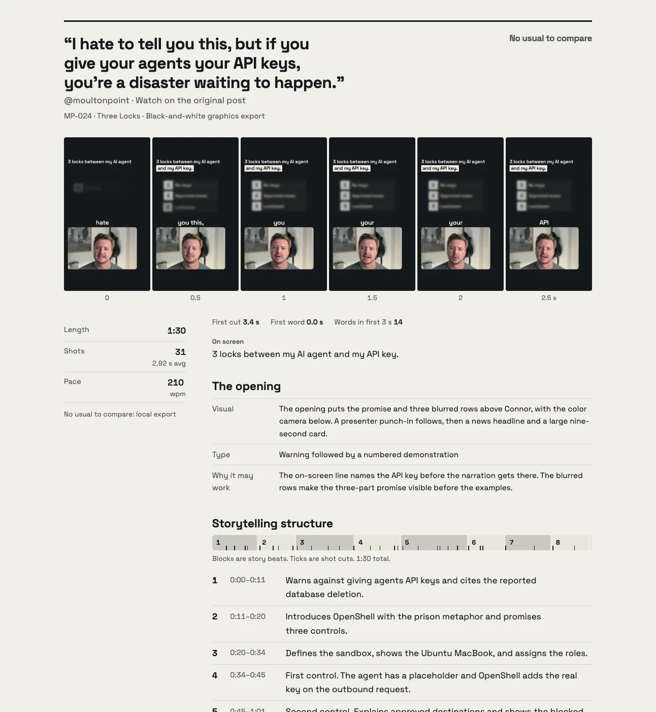

# analyze

Paste TikTok, Instagram Reels or YouTube Shorts links into your agent and get one HTML report: the first three seconds frame by frame, the opening line, where every shot cuts, the story beats, and how each video did against its creator's usual views. The downloads and frames stay on your computer, and your agent's model reads them to write the analysis. No account needed.

<p align="center"></p>

`SKILL.md` in this folder is written for the agent. This page is for you.

## Install

1. Install Node.js 20 or newer, yt-dlp and ffmpeg (ffprobe comes with it). On a Mac: `brew install node yt-dlp ffmpeg`. Windows and YouTube setup are in the [main README](../../../README.md#installation).
2. Add the skill to your agent. In Claude Code:

   ```text
   /plugin marketplace add moultonpoint/skills
   /plugin install moultonpoint-skills@moultonpoint
   ```

   Codex and local installs are in the [main README](../../../README.md#installation).

## Use it

Start a session in the folder where you want the report, then ask in plain words:

| You want | Say |
|---|---|
| One video broken down | `Use analyze on <video link>.` |
| What several videos share | `Analyze these and tell me what they have in common: <link> <link> <link>` |
| A creator's best posts | `Analyze <TikTok profile or YouTube channel link>.` The agent ranks their last 30 posts first, picks the ones that beat their usual, adds a couple that didn't for contrast, and tells you why it picked them. |

Links must be public and start with `https://`. Instagram usually needs your signed-in browser session, and the agent asks before using it; say no and that link is left out. Instagram videos have no usual views to compare and no captions, so their cards are thinner.

## What you get

A folder `./analyze/<date>-<name>/` with:

- `report.html`: the report. It works offline and is safe to send to someone as one file.
- `cheatsheet.html`: one printable page with what to take, the best openings and what to test.
- `metrics.csv`: one row per video for a spreadsheet. Import the `id` column as text.

With several videos the report opens on the best one against its creator's usual, then a board ranking every video, the patterns they share, the numbers side by side, and a full card per video.

## Reading the numbers

- **2.5×** means 2.5 times the creator's usual views: the middle of their other recent posts. Anything from 0.9× to 1.1× is about usual.
- An older video is compared with newer posts, so its multiple runs high. The report says when that happens.
- Everything comes from public counts. It can't see watch time or where viewers came from, and paid promotion can inflate views. A caption with a link or a #ad-style tag is flagged so you can check.

## If something goes wrong

- **A link fails to fetch:** check that it's public, then ask the agent to try again. TikTok sometimes returns empty lists.
- **"report.html exists":** the folder already has a report. Ask for a new folder, or tell the agent to replace it.
- **Check the install:** `node scripts/selfcheck.mjs` in this folder tests everything offline.

MIT licensed. Made by [moultonpoint](https://linktr.ee/moultonpoint).
